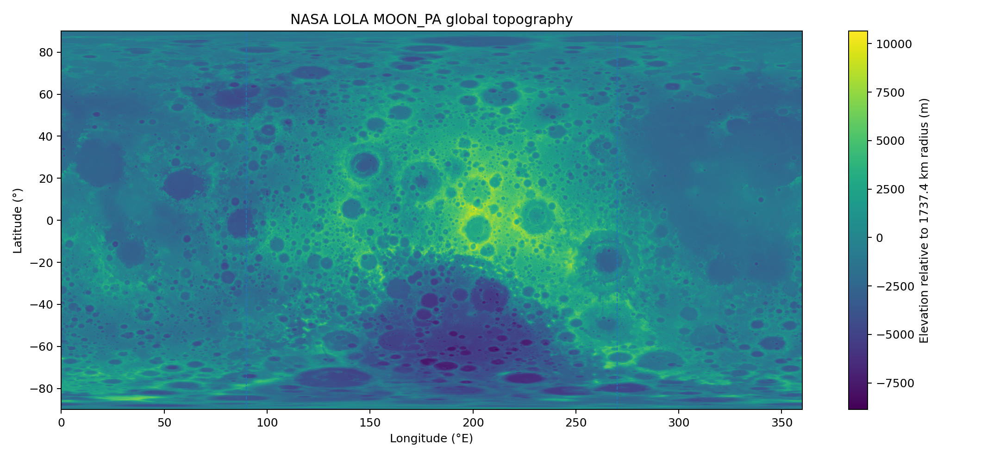
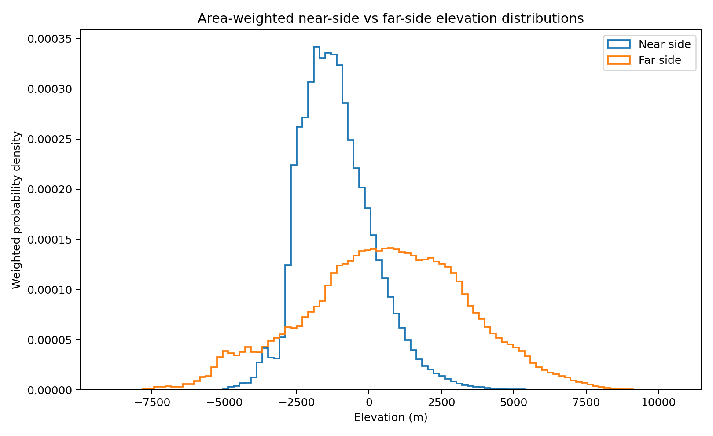
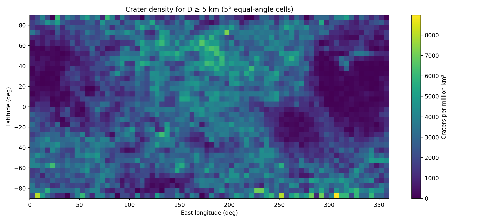
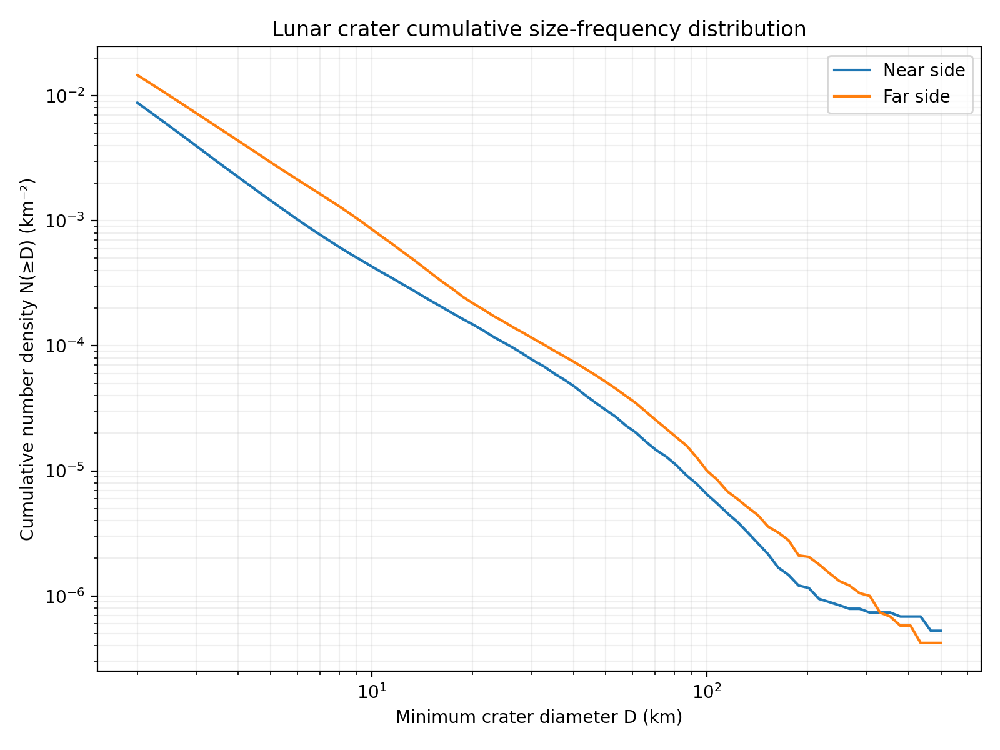

# Lunar Hemisphere Analysis

[](https://www.python.org/)
[](#tests)
[](#validated-datasets)
[](LICENSE)

A reproducible Python planetary-data project comparing the Moon's **near side** and **far side** with real NASA LOLA topography and the Robbins lunar crater catalog.

This repository is a computational companion to Ali Razeghi's article **“The Hidden but Wonderful Side of the Moon.”**

## Validated datasets

- NASA Goddard **LOLA MOON_PA** global DEM, 64 pixels/degree, `23040 × 11520` cells (~265 million).
- **Robbins lunar crater database (2018)**: `1,296,796` crater records in the validated CSV.

Raw datasets are excluded from Git because of their size.

## Validated real-data results

| Metric | Near side | Far side |
|---|---:|---:|
| Mean elevation | -1,103 m | +606 m |
| Median elevation | -1,249 m | +672 m |
| Elevation standard deviation | 1,286 m | 2,787 m |
| Minimum | -6,591 m | -9,125 m |
| Maximum | +7,016 m | +10,766 m |

The mean far-side elevation is about **1.71 km higher** than the near side in this analysis.

### Crater counts and equal-area density ratios

| Minimum diameter | Near | Far | Far/Near |
|---:|---:|---:|---:|
| ≥1 km | 560,178 | 736,618 | 1.315 |
| ≥2 km | 166,403 | 276,613 | 1.662 |
| ≥5 km | 27,475 | 55,586 | 2.023 |
| ≥20 km | 2,812 | 4,161 | 1.480 |

For the `83,061` craters ≥5 km, median LOLA elevation at crater centers was approximately `-1086.5 m` on the near side and `+479.4 m` on the far side. The simple correlation between `log10(diameter)` and center elevation was weak (`r ≈ -0.105`).


## Scientific output

### Global LOLA topography



### Near-side vs far-side elevation distribution



### Crater density for D ≥ 5 km



### Cumulative crater size-frequency distribution



Additional validated figures, the numerical table, and the analysis report are available in [`results/`](results/).


## Scientific safeguards

- Correct handling of the DEM's native `0–360°` longitude convention.
- Near/far hemispheres are geometric, centered on 0° and 180° longitude.
- Global raster statistics use latitude-area weighting (`cos(latitude)`).
- Full-resolution means can be block-streamed without loading the ~265M-cell DEM into RAM.
- Crater density is normalized by surface area.
- Diameter-threshold dependence is reported explicitly.
- Tiny p-values from very large samples are not treated as effect size.
- No direct conversion of crater count to absolute surface age is attempted.

## Install

```powershell
python -m venv .venv
.venv\Scripts\activate
pip install -e ".[dev]"
```

## Run

```powershell
lunar-analyze `
  --dem "data/raw/LDEM64_PA_pixel_202405.tif" `
  --craters "data/raw/lunar_crater_database_robbins_2018.csv" `
  --native-means
```

Use the actual extracted Robbins CSV filename.

## Tests

```powershell
pytest -q
```

## Companion article

**Ali Razeghi -  [The hidden but wonderful side of the moon](https://www.linkedin.com/pulse/hidden-wonderful-side-moon-ali-razeghi-vl5ae)**

The article discusses the Moon's hemispheric asymmetry, the far side's rugged terrain and crater-rich morphology, impact history, and South Pole–Aitken context. This repository turns those qualitative scientific themes into a reproducible quantitative analysis using LOLA topography and the Robbins crater catalog.

## Reproducibility

The large raw datasets are not stored in Git. Place the downloaded source files under `data/raw/`, then run the CLI. Validated result figures are retained in `results/` so readers can inspect the real-data output without downloading ~1 GB of source data.

## Primary references

- Neumann, G. (2024), *LOLA MOON_PA gridded dataset*, NASA GSFC Planetary Geodesy Data Archive. DOI: `10.60903/LOLA_PA`.
- Robbins, S. J. (2019), *A New Global Database of Lunar Impact Craters >1–2 km: 1.3 Million Craters*, JGR Planets.

## License

MIT for code. External datasets retain their own terms and citation requirements.
